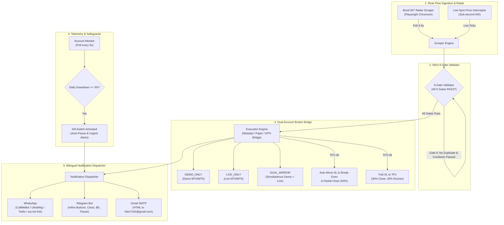

# 🏅 XAUUSD (Gold) 24/7 Automated Trading, Account Monitoring & Multi-Channel Alert System
## 🤖 24/7 گولڈ آٹو ٹریڈنگ، لائیو مانیٹرنگ اور الرٹ انجن (English & Roman Urdu Guide)

[](https://github.com/azzemeb606-cpu/xauusd-trading-bot/actions)
[](https://opensource.org/licenses/MIT)
[](https://www.docker.com/)
[](https://reactjs.org/)
[](https://nodejs.org/)

A production-grade, full-stack monorepo web application engineered for 24/7 non-stop gold (XAU/USD) automated trading, continuous dual-account telemetry (MT4/MT5 Demo & Live), and instant multi-channel alerts across **WhatsApp**, **Telegram**, and **Email (`irfan7242@gmail.com`)** in both **English** and **Roman Urdu**.

---

## 📑 Table of Contents / فہرست
1. [Architecture & System Modules](#-architecture--system-modules)
2. [Folder Structure](#-folder-structure)
3. [Strict 6-Gate Trade Criteria Validator](#-strict-6-gate-trade-criteria-validator)
4. [Dual Account MT4/MT5 Bridge & Modes](#-dual-account-mt4mt5-bridge--modes)
5. [Multi-Channel Notification Dispatcher](#-multi-channel-notification-dispatcher)
6. [Frontend Web Dashboard](#-frontend-web-dashboard)
7. [Step-by-Step Setup Guide (Roman Urdu + English)](#-step-by-step-setup-guide-roman-urdu--english)
   - [A. MetaApi.cloud MT4/MT5 Connection](#a-metaapicloud-mt4mt5-account-connection)
   - [B. WhatsApp CallMeBot Setup](#b-whatsapp-callmebot-free-api-setup)
   - [C. Gmail SMTP Setup (`irfan7242@gmail.com`)](#c-gmail-smtp-setup)
   - [D. Telegram Bot API Setup](#d-telegram-bot-api-setup)
8. [1-Click Cloud Deployment Guides](#-1-click-cloud-deployment-guides)
   - [Render Deployment (`render.yaml`)](#1-render-1-click-deploy)
   - [Railway Deployment (`railway.json`)](#2-railway-1-click-deploy)
   - [Self-Hosted VPS (Docker Compose)](#3-vps-self-hosted-deployment-docker-compose)
   - [GitHub Actions CI/CD](#4-github-actions-cicd)
9. [Double-Lock Live Safety Safeguard](#-double-lock-live-safety-safeguard)
10. [Local Development & Testing](#-local-development--testing)

---

## 🏛️ Architecture & System Modules



---

## 📁 Folder Structure

```
c:\BLT/
├── backend/                  # Node.js + TypeScript 24/7 backend engine
│   ├── src/
│   │   ├── config.ts         # Environment variables validation & defaults
│   │   ├── engine/           # 6-Gate Validator & Decision Engine
│   │   │   └── validator.ts
│   │   ├── services/         # Execution, broker bridge, telemetry & account monitor
│   │   │   ├── accountMonitor.ts
│   │   │   ├── brokerBridge.ts
│   │   │   └── tradeManager.ts
│   │   ├── notify/           # Multi-channel notification dispatcher (WhatsApp, Telegram, Email)
│   │   │   ├── dispatcher.ts
│   │   │   ├── formatters.ts # Bilingual (English + Roman Urdu) message templates
│   │   │   ├── telegram.ts
│   │   │   ├── whatsapp.ts
│   │   │   └── email.ts
│   │   ├── scraper/          # Playwright Chromium scraper & WebSocket price bridge
│   │   │   ├── browser.ts
│   │   │   ├── radarScraper.ts
│   │   │   └── spotScraper.ts
│   │   ├── db/               # SQLite schema & persistence (trades, alerts, equity snapshots)
│   │   └── server.ts         # Express REST API & Socket.IO server
│   ├── package.json
│   ├── tsconfig.json
│   └── vitest.config.ts
├── frontend/                 # React 18 + Vite + Tailwind CSS dark-mode dashboard
│   ├── src/
│   │   ├── components/       # UI panels (Control Bar, Account Cards, Radar, Logs, Settings)
│   │   ├── context/          # Socket.IO & State provider
│   │   ├── App.tsx
│   │   └── main.tsx
│   ├── package.json
│   ├── tailwind.config.js
│   └── vite.config.ts
├── shared/                   # Shared TypeScript models and interfaces
│   └── types.ts              # Signal, Trade, Account, SafetyGates, and Alert types
├── .github/
│   └── workflows/
│       └── deploy.yml        # CI/CD: Automated testing, Docker build & VPS auto-deploy
├── Dockerfile                # Multi-stage production build (Frontend + Backend + Playwright)
├── docker-compose.yml        # Container orchestration with persistent SQLite volume
├── render.yaml               # 1-Click deployment blueprint for Render.com
├── railway.json              # 1-Click deployment config for Railway.app
├── .env.example              # Fully commented template for all environment variables
└── README.md                 # Complete bilingual documentation
```

---

## 🛡️ Strict 6-Gate Trade Criteria Validator
**چھ سخت شرائط جن کی تصدیق کے بغیر کوئی آٹو ٹریڈ نہیں کھلے گی:**

Before placing any trade, the decision engine evaluates all 6 criteria simultaneously:

| Gate # | Name / نام | English Rule | Roman Urdu Wazaahat |
|---|---|---|---|
| **Gate 1** | **Safety Gate Check** | Execution Safety Gates NOT blocked (`overall !== TRADE_BLOCKED`), Market Expansion is **NOT "CHOP MARKET"**, Spread <= `MAX_SPREAD` (default 0.80), and no high-impact USD news within 15 min. | Agar market chop ho ya spread 0.80 se zyada ho ya 15 minute ke andar koi high impact news ho to trade block ho jayegi. |
| **Gate 2** | **Fusion Confluence** | Fusion Confidence must be **>= 65%** and Brains Agreement (>= 5 engines) must align with the trade direction. | Kam az kam 65% confidence aur 5 brains ka ittefaq hona lazmi hai taake false signal se bacha ja sake. |
| **Gate 3** | **Whale & Session** | Whale Matrix flow must not oppose trade (BUY cannot have SELLING whale flow; SELL cannot have BUYING whale flow). Active in Asia/London/NY. | Baray institutions (Whales) ke flow ke khilaf trade nahi kholi jayegi. Agar whale selling kar rahi hai to buy block hoga. |
| **Gate 4** | **Price-in-Zone** | Live price must enter the valid Demand/Supply entry zone (`Entry Low <= Price <= Entry High`) for Market Orders, OR within $15 for Pending Limit Orders at Anchor Price. | Price ka entry zone ke andar hona zaroori hai. Agar price $15 ke andar ho to anchor price par pending limit order lagaya ja sakta hai. |
| **Gate 5** | **Risk-to-Reward & SL** | Buy: `SL < Entry Low` & `TP1 > Entry High`. Sell: `SL > Entry High` & `TP1 < Entry Low`. Volume-weighted **R:R >= 1:1.5**. | Risk to reward ratio kam az kam 1:1.5 hona lazmi hai aur Stop Loss zone ke bilkul theek bahar hona chahiye. |
| **Gate 6** | **Duplicate & Cooldown** | No duplicate trade for the same setup/zone. Enforce a **30-minute cooldown** after any Stop Loss hit. | Ek hi zone par doosri trade nahi khulay gi aur agar Stop Loss hit ho to agle 30 minute tak naya order block rahega. |

---

## 💼 Dual Account MT4/MT5 Bridge & Modes

The bot seamlessly connects to any MT4 or MT5 broker via **MetaApi.cloud** (requiring no VPS for Windows MT4/MT5) and provides 3 operational modes:

1. **`DEMO_ONLY` (Safe Default / محفوظ ترین موڈ)**:
   - All auto-trades are executed exclusively on your Demo Account.
   - Monitors balance, equity, win rate, and drawdown without touching real funds.
2. **`LIVE_ONLY` (Live Account Trading)**:
   - Executes auto-trades directly on your funded Live Account.
   - Requires live double-lock safety flags in `.env`.
3. **`DUAL_MIRROR` (Simultaneous Mirroring / دونوں اکاؤنٹس ایک ساتھ)**:
   - Opens trade on Demo and immediately mirrors identical position sizing to Live account.

### Dynamic Position Sizing & Multi-TP Automation:
- **Exact Lot Calculation**: $\text{Lots} = \frac{\text{Account Balance} \times \text{Risk } \%}{\text{SL Distance (\$) } \times 100}$.
- **Multi-Leg Split**:
  - **TP1 (50% Volume)**: Closes 50% at TP1.
  - **Auto Break-Even**: As soon as TP1 hits, Stop Loss for the remaining 50% volume is automatically moved to `Entry Price + $0.30` (risk-free trade!).
  - **TP2 (30% Volume)**: Closes at TP2; Stop Loss of TP3 is trailed to TP1.
  - **TP3 (20% Volume)**: Runner leg left to capture massive swing moves.
- **Daily Drawdown Kill-Switch**: If daily loss on either account hits **3.0%** (warning) or **5.0%** (max), new trades are immediately frozen for the day and urgent alerts are dispatched.

---

## 📢 Multi-Channel Notification Dispatcher

Har event par instant **Roman Urdu + English** notification bheji jati hai:

### 5 Core Notification Events / 5 بنیادی الرٹ ایونٹس:
1. **Event A — Signal Detected / Pending Setup Ready**
   - *Roman Urdu*: `🚨 NAYA GOLD SETUP DETECTED! Type: BUY LIMIT | Entry: $2742.50 | SL: $2736.00 | TP1: $2752.00 | Confidence: 78%`
2. **Event B — Auto-Trade Executed (Buy/Sell Opened)**
   - *Roman Urdu*: `⚡ AUTO-TRADE OPEN HOGAYI! Account: DEMO (#1098273) | Action: BUY | Lots: 0.15 | Price: $2743.10 | Risk: $100 (1.0%)`
3. **Event C — TP1 Hit & SL Moved to Break-Even**
   - *Roman Urdu*: `🎯 TP1 HIT HOGAYA! 50% Profit Book ($75). Baqi position ka Stop Loss Entry Price ($2743.10) par shift kardia gaya hai. Trade ab bilkul RISK-FREE hai!`
4. **Event D — Trade Closed (TP2/TP3 Hit or SL Hit)**
   - *Roman Urdu*: `🏁 TRADE COMPLETE! Result: PROFIT (+$165.40) | Balance: $10,165.40 | Equity: $10,165.40`
5. **Event E — Safety Gate / Drawdown Warning**
   - *Roman Urdu*: `⚠️ RISK ALERT! Daily Drawdown 3.2% tak pohanch gaya hai. Nayi trades pause kardi gayi hain.`

### Supported Channels:
- **WhatsApp**: CallMeBot Free Personal API, UltraMsg API, Twilio API, and 1-click `https://wa.me/` direct share link.
- **Email (Gmail SMTP)**: Rich HTML emails sent directly to **`irfan7242@gmail.com`**.
- **Telegram Bot API**: Push notifications with inline buttons (`Close Trade`, `Move SL to BE`, `Pause Bot`).

---

## 🖥️ Frontend Web Dashboard

A responsive dark-mode Gold trading dashboard built with **React 18** and **Tailwind CSS**:
- **Top Control Bar**: Master Auto-Trading toggle (ON/OFF), Execution Mode selector (`DEMO_ONLY`, `LIVE_ONLY`, `DUAL_MIRROR`), Scanner Status, and Emergency Kill-Switch.
- **Demo & Live Account Monitor Cards**: Side-by-side cards showing Balance, Equity, Floating P&L, Win Rate, Daily Realized Profit, and active open orders with 1-click "Close Trade" and "Move SL to BE" buttons.
- **Bond 007 Live Radar Panel**: Live XAU/USD price, Fusion Verdict gauge, 9 Execution Safety Gates checklist, Zone Ladder progress bar, and active Buy/Sell cards.
- **Settings & Credentials Modal**: Dynamic form to update Risk %, Max Spread, Daily Loss %, MT4/MT5 credentials, WhatsApp number, and Email.
- **Trade & Alert Log Table**: Full searchable audit trail of signals, trades, and notification history.

---

## 📖 Step-by-Step Setup Guide (Roman Urdu + English)

### A. MetaApi.cloud MT4/MT5 Account Connection
**MetaApi ke zariye apna MT4 ya MT5 broker account connect karne ka tareeqa:**

1. **Sign Up on MetaApi**: Go to [https://metaapi.cloud](https://metaapi.cloud) and create a free account.
2. **Get API Token**: Navigate to **API Access** in the dashboard and copy your **MetaApi Token**.
3. **Add Broker Account**:
   - Click **Add Account**.
   - Select your platform (**MetaTrader 4** or **MetaTrader 5**).
   - Enter your broker server name (e.g. `Exness-Real10`, `ICMarkets-Demo`).
   - Enter your Account Login Number and Trading/Investor Password.
4. **Copy Account IDs**: Once deployed, copy the generated UUID for your **Demo Account** and **Live Account**.
5. **Add to `.env`**:
   ```env
   EXECUTION_ENGINE=metaapi
   METAAPI_TOKEN=your_metaapi_token_here
   DEMO_ACCOUNT_ID=your_demo_account_uuid_here
   LIVE_ACCOUNT_ID=your_live_account_uuid_here
   DEMO_SYMBOL=XAUUSD
   LIVE_SYMBOL=XAUUSD
   ```

*(Roman Urdu: MetaApi cloud par account bana kar apna MT4/MT5 broker login karein. Wahan se milne wala Token aur Account ID apne `.env` file mein daal dein).*

---

### B. WhatsApp CallMeBot Free API Setup
**CallMeBot se muft WhatsApp alerts shuru karne ka tareeqa:**

CallMeBot provides a free gateway to receive WhatsApp alerts directly on your phone:
1. Save the phone number **`+34 644 44 49 19`** in your phone contacts as *CallMeBot*.
2. Open WhatsApp and send this message to that number:
   ```text
   I allow callmebot to send me messages
   ```
3. Wait 10 to 60 seconds. CallMeBot will reply with your personal **API Key** (e.g., `123456`).
4. In `.env`, configure:
   ```env
   WHATSAPP_PROVIDER=callmebot
   CALLMEBOT_RECIPIENTS=923001234567:123456
   ```
   *(Replace `923001234567` with your phone number including country code without `+`, followed by a colon and your API key).*

---

### C. Gmail SMTP Setup
**Gmail ke zariye `irfan7242@gmail.com` par email alerts bhejne ka tareeqa:**

1. Go to your Google Account security settings: [https://myaccount.google.com/security](https://myaccount.google.com/security).
2. Ensure **2-Step Verification** is turned ON.
3. Open **App Passwords**: [https://myaccount.google.com/apppasswords](https://myaccount.google.com/apppasswords).
4. Create a new App Password named `Gold Trading Bot` and copy the 16-character code (e.g. `abcd efgh ijkl mnop`).
5. In `.env`, configure:
   ```env
   SMTP_HOST=smtp.gmail.com
   SMTP_PORT=587
   SMTP_SECURE=false
   SMTP_USER=your_sending_gmail@gmail.com
   SMTP_PASS=abcdefghijklmnop
   EMAIL_FROM=XAUUSD Bot <your_sending_gmail@gmail.com>
   EMAIL_TO=irfan7242@gmail.com
   ```

*(Roman Urdu: Gmail account se 16-character ka App Password generate karein aur `.env` mein `SMTP_PASS` mein paste kar dein. Alerts seedha `irfan7242@gmail.com` par receive honge).*

---

### D. Telegram Bot API Setup
**Telegram Bot banana aur alerts connect karna:**

1. Open Telegram and search for **`@BotFather`**.
2. Send `/newbot`, give it a name (e.g. `XAUUSD Gold Alert Bot`) and username (e.g. `xauusd_007_bot`).
3. Copy the **HTTP API Bot Token** provided by BotFather.
4. Start your new bot by clicking `/start`.
5. To get your **Chat ID**, search for **`@userinfobot`** on Telegram and send `/start`. It will reply with your numeric `Id`.
6. In `.env`, configure:
   ```env
   TELEGRAM_BOT_TOKEN=7123456789:ABCdefGhIJKlmNoPQRsTUVwxyZ
   TELEGRAM_CHAT_IDS=123456789
   ```

---

## 🚀 1-Click Cloud Deployment Guides

### 1. Render (1-Click Deploy)
Render automatically builds and runs the bot via [`render.yaml`](file:///c:/BLT/render.yaml):
1. Push this repository to your GitHub account:
   ```bash
   git init
   git add .
   git commit -m "feat: XAUUSD 24/7 Automated Trading Bot"
   git remote add origin https://github.com/YOUR_USERNAME/xau-bot.git
   git push -u origin main
   ```
2. Go to [https://dashboard.render.com](https://dashboard.render.com).
3. Click **New +** -> **Blueprint**.
4. Select your GitHub repository.
5. Render reads `render.yaml`, configures a persistent 10GB disk at `/app/data`, and provisions the service.
6. Under **Environment**, fill in your secret keys (`METAAPI_TOKEN`, `DEMO_ACCOUNT_ID`, `SMTP_PASS`, `TELEGRAM_BOT_TOKEN`, etc.).
7. Click **Apply**. Your bot will be live with a free HTTPS URL!

---

### 2. Railway (1-Click Deploy)
Railway uses the root [`railway.json`](file:///c:/BLT/railway.json) and [`Dockerfile`](file:///c:/BLT/Dockerfile):
1. Go to [https://railway.app](https://railway.app) and click **New Project**.
2. Select **Deploy from GitHub repo** and choose this repository.
3. Add a **Persistent Volume** mounted at `/app/data` to keep SQLite trade and telemetry history safe across restarts.
4. In the **Variables** tab, copy and paste the values from your `.env` file.
5. Railway automatically builds the multi-stage Docker container and deploys your bot with automatic restarts!

---

### 3. VPS Self-Hosted Deployment (Docker Compose)
To run on any Ubuntu/Debian/CentOS Linux VPS:
```bash
# 1. Clone repository
git clone https://github.com/YOUR_USERNAME/xau-bot.git /opt/xau-bot
cd /opt/xau-bot

# 2. Configure environment
cp .env.example .env
nano .env   # Fill in your tokens and credentials

# 3. Start 24/7 container with Docker Compose
docker compose up -d

# 4. View real-time logs
docker compose logs -f xau-bot
```
The dashboard will be available at `http://YOUR_SERVER_IP:8080`.

---

### 4. GitHub Actions CI/CD
Whenever you push code updates to `main`:
- The pipeline in [`.github/workflows/deploy.yml`](file:///c:/BLT/.github/workflows/deploy.yml) automatically executes:
  1. TypeScript compilation and Vitest unit tests in `backend/`.
  2. Vite production build in `frontend/`.
  3. Builds and pushes the Docker image to GitHub Container Registry (`ghcr.io`).
  4. Deploys via SSH to your VPS and restarts the container with zero downtime.

Add these secrets in GitHub (**Settings -> Secrets and variables -> Actions**):
- `DEPLOY_HOST`: Your VPS IP address
- `DEPLOY_USER`: SSH username (`ubuntu` or `root`)
- `DEPLOY_SSH_KEY`: Your private SSH key
- `DEPLOY_DIR`: `/opt/xau-bot`

---

## 🔒 Double-Lock Live Safety Safeguard
**لائیو اکاؤنٹ پر غلطی سے ٹریڈ لگنے سے بچاؤ کے لیے ڈبل لاک:**

To prevent accidental live executions, the system strictly enforces a double-lock in `.env`:
```env
LIVE_TRADING_ENABLED=true
LIVE_TRADING_CONFIRM=I_UNDERSTAND_THE_RISK
```
If either parameter is missing, the backend **completely blocks** any real-money order and defaults safely to `DEMO_ONLY`.

---

## 🧪 Local Development & Testing

### Run Backend & Frontend in Development:
```bash
# Install dependencies for all workspaces
npm install

# Start backend server with hot-reload (port 8080)
npm run dev:backend

# Start frontend dashboard with Vite (port 5173)
npm run dev:frontend
```

### Run Unit & Integration Tests:
```bash
# Run 18 comprehensive tests covering 6-Gate Validator, Risk Sizer & Notifier
npm test
```

---

## 📞 Support & Community
- **Target Recipient Email**: [`irfan7242@gmail.com`](mailto:irfan7242@gmail.com)
- **WhatsApp Support**: Direct link via [wa.me/34644444919](https://wa.me/34644444919)
- **Documentation**: Roman Urdu & English guides included in `/docs` and inline comments.

*Trade responsibly. Always test thoroughly in DEMO_ONLY mode before enabling live trading.*
